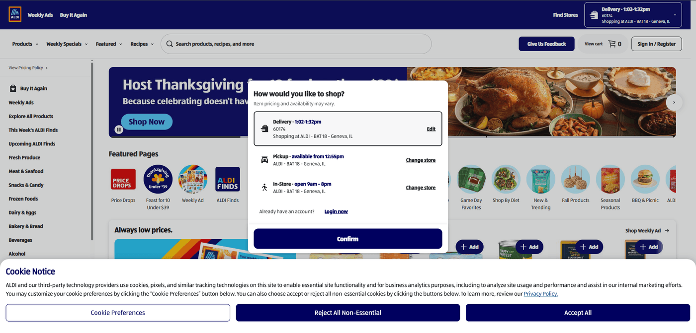
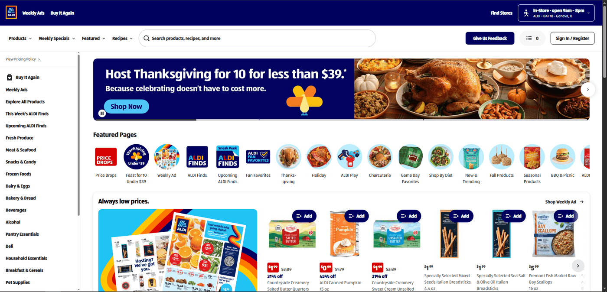
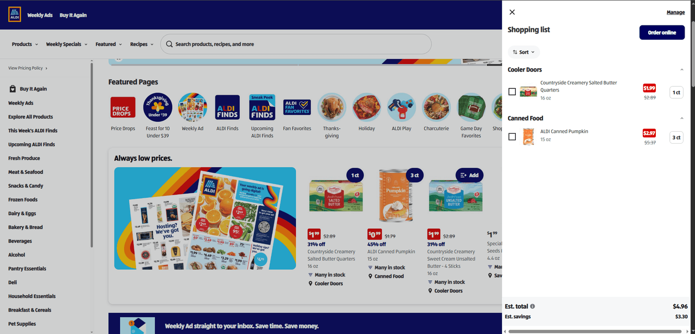
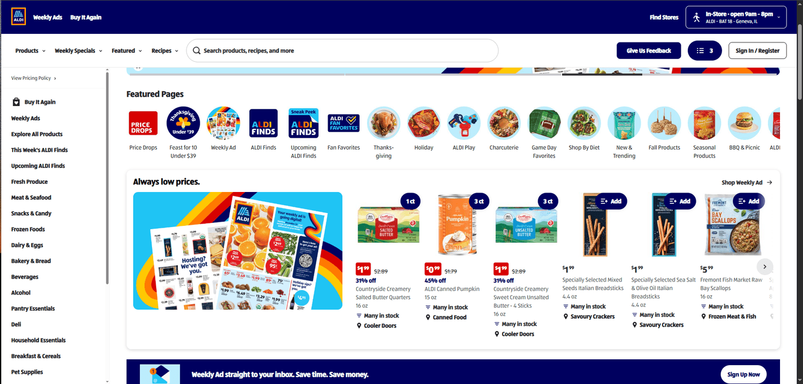

# Task 1 – Manual testing: "Add to Shopping List" on aldi.us

- [1. Test basis: how the feature works today](#1-test-basis-how-the-feature-works-today)
- [2. Test case fields](#2-test-case-fields)
- [3. Test cases](#3-test-cases)
- [4. Further scenarios](#4-further-scenarios)
- [5. Bug report fields](#5-bug-report-fields)
- [6. Sample bug report](#6-sample-bug-report)
- [7. Observation from the exploratory session](#7-observation-from-the-exploratory-session)

## 1. Test basis: how the feature works today

Since March 2026 aldi.us has run on Instacart's storefront technology. On this platform the
shopping list belongs to the **In-Store** shopping mode. With Delivery or Pickup selected, the
product tiles add to the cart. With In-Store selected, they add to a shopping list that is
organised by where the products are in the chosen store. Before writing the test cases, I ran
a short exploratory session on the live site.

| Item | Observed on 21 Nov 2026 |
| --- | --- |
| Environment | Windows desktop, Google Chrome (private window), production `https://www.aldi.us` |
| Store / ZIP | ALDI - BAT 18 - Geneva, IL, ZIP 60174 (preselected by the site; the visit came from outside the US) |
| First visit | A **Cookie Notice** (Cookie Preferences / Reject All Non-Essential / Accept All) and the **"How would you like to shop?"** dialog (Delivery / Pickup / In-Store + Confirm). Both appear again in every new private session. |
| In-Store mode | The header shows "In-Store · open 9am - 8pm, ALDI - BAT 18 - Geneva, IL". The "View cart" button becomes a **list button with a counter**. Product tiles show an **"Add"** button with a list icon, the stock level ("Many in stock") and the **in-store location** ("Cooler Doors", "Canned Food"). |
| After "Add" | The button turns into a quantity stepper (e.g. "− 3 ct +"; at 1 ct a trash icon takes the place of "−"), which collapses into a badge with the quantity (e.g. "1 ct"). The header counter shows the number of **different products** (1 × butter + 3 × pumpkin = **2**). |
| Shopping list drawer | Title "Shopping list", buttons "Manage", "Order online" and "Sort". Items are **grouped by store location**. Every line has a checkbox, image, name, size, line price (sale price × quantity, with the regular price struck through) and quantity. The footer shows **Est. total** and **Est. savings**. |
| Guest (not signed in) | Products can be added **without signing in**. The list is **kept after a page reload (F5)**. |

| First visit (fresh private window) | In-Store mode, empty list |
| --- | --- |
|  |  |
| **Products added: stepper, location, counter** | **Shopping list drawer: groups, totals** |
|  |  |

**Scope:** adding products to the shopping list on the desktop website, and checking the result
in the list (quantities, grouping, prices, totals, persistence) for guests and signed-in customers.

**Out of scope:** checkout and payment, the mobile app, and the Delivery/Pickup cart. The cart
is only touched where it borders on the list (see [section 4](#4-further-scenarios)).

**Assumptions:**

- The test cases use the store and products I observed. Prices come from the weekly ad that was
  running on 21 Nov 2026, so the expected amounts are recalculated from the prices shown at
  execution time.
- Signed-in runs need a dedicated test account (`TEST_USER_A` in this document). The guest flows
  were verified in the exploratory session on 21 Nov 2026, and on 25 Nov 2026 I also executed
  the test cases manually with an account of my own.
- No written requirements were provided. The requirement IDs (`US-LIST-01` … `03`) are
  illustrative user stories derived from the observed behaviour and the platform documentation,
  so that each test case shows what it traces to.

## 2. Test case fields

| Field | Why it is needed |
| --- | --- |
| **ID** | Unique, stable reference for traceability and defect linking (e.g. `TC-ASL-001`). |
| **Title** | One line that says what is verified. |
| **Feature / component** | Groups test cases and routes defects to the right team. |
| **Requirement / user story** | Traceability: which acceptance criterion the test proves (shows coverage gaps). |
| **Type** | Positive / negative, functional / non-functional – shows the balance of the suite. |
| **Priority** | Execution order under time pressure (smoke → regression). |
| **Preconditions** | System and user state before step 1, so every tester starts from the same point. |
| **Test data** | Exact inputs (store, products, account), so results are reproducible. |
| **Environment** | URL, browser/OS, device/viewport – many web defects are environment-specific. |
| **Steps + expected result per step** | Verifiable checkpoints: a failure points to the exact step. |
| **Expected result (overall)** | The pass criterion of the whole test case. |
| **Postconditions / cleanup** | Leaves the system ready for the next run (no leftover list items). |
| **Automation candidate** | Feeds the automation backlog (stable, repeatable, high value = automate). |
| **Execution fields** – actual result, status (Pass / Fail / Blocked / Not run), tester, date, build, defect ID, attachments | Filled in during each run. They are the audit trail and the evidence for the release decision. |

In a test management tool (e.g. Jira Xray) these map to the Test issue fields. The steps table
maps to the manual test steps (Action / Data / Expected Result).

## 3. Test cases

### TC-ASL-001 – Add a single product to the shopping list as a signed-in user

| Field | Value |
| --- | --- |
| ID | TC-ASL-001 |
| Feature / component | Shopping list – "Add" on the product tile (In-Store mode) |
| Requirement | US-LIST-01: *As a shopper planning a store visit, I can add a product to my shopping list.* |
| Type | Functional, **positive** (happy path) |
| Priority | High – smoke |
| Preconditions | 1. A new private window with aldi.us open (the Cookie Notice and the "How would you like to shop?" dialog only appear by themselves in a fresh session). 2. The Cookie Notice is closed (e.g. **Reject All Non-Essential**) and the shopping-mode dialog is confirmed with any mode (steps 1–2 set the mode). 3. Signed in as test customer `TEST_USER_A`. 4. The shopping list is empty (counter shows 0). |
| Test data | Store: ALDI - BAT 18 - Geneva, IL. Product A: *Countryside Creamery Salted Butter Quarters, 16 oz* (location "Cooler Doors"; $1.99, regular $2.89 on 21 Nov 2026). Any in-stock product can replace it. |
| Environment | Desktop Chrome (latest stable), Windows 11, 1920 × 1080, production aldi.us |
| Automation candidate | Yes – smoke test with a dedicated test account |

| # | Action | Expected result |
| --- | --- | --- |
| 1 | Click the shopping-mode selector in the header (top right). | The "How would you like to shop?" dialog opens with Delivery, Pickup and In-Store; the current mode is highlighted. |
| 2 | Select **In-Store** (ALDI - BAT 18 - Geneva, IL) and click **Confirm**. | The dialog closes. The header shows "In-Store · open … / ALDI - BAT 18 - Geneva, IL". The cart button changes to a list button with counter **0**. Tiles show "Add" with a list icon, a stock level and an in-store location. |
| 3 | Search for `salted butter` (field "Search products, recipes, and more") and press Enter. | Product A is in the results with its price, stock level and location "Cooler Doors". |
| 4 | Note the price of Product A, then click its **Add** button. | The button changes to the quantity stepper showing **1 ct**. The header counter changes from 0 to **1**. No error message. |
| 5 | Click the list button in the header. | The **Shopping list** drawer opens. Product A is listed **once** under the heading **Cooler Doors**: checkbox unchecked, image, name, "16 oz", the price noted in step 4, quantity **1 ct**. |
| 6 | Check the drawer footer. | **Est. total** = the price of Product A. **Est. savings** = regular price − sale price ($0.90 on 21 Nov 2026), or $0.00 if the product is not on sale. |
| 7 | Close the drawer and reload the page (F5). | Still In-Store mode. The counter still shows 1 and the tile still shows "1 ct". |

- **Expected result:** Product A is on the shopping list exactly once, with quantity 1, the
  correct price and location, and the header counter shows 1.
- **Postconditions:** Remove Product A with the trash icon (at 1 ct it takes the place of "−" on
  the stepper), so the list is empty again.

### TC-ASL-002 – Attempt to add a product without being logged in

| Field | Value |
| --- | --- |
| ID | TC-ASL-002 |
| Feature / component | Shopping list – guest (anonymous) session, sign-in transition (merging the guest list) |
| Requirement | US-LIST-02: *A visitor can build a shopping list without an account; it is kept for the visit, is not visible to anybody else, and its items are added to the account's list on sign-in.* Guest shopping is the platform default: guests can add items without logging in and only need an account to check out. The platform documentation does not describe what happens to the guest list on sign-in. |
| Type | **Negative** / access control: the user is not authenticated |
| Priority | High |
| Preconditions | No ALDI session. **Close every private window first:** Chrome shares one private session between all open private windows. Steps 9–13 also need test account `TEST_USER_A` with an empty list. |
| Test data | Product B: *ALDI Canned Pumpkin, 15 oz* (search term `canned pumpkin`; location "Canned Food"; $0.99, regular $1.79 on 21 Nov 2026) |
| Environment | Desktop Chrome (latest stable), private window, production aldi.us |
| Automation candidate | Yes – every Playwright test starts in a fresh, incognito-like browser context, which is exactly this precondition |

| # | Action | Expected result |
| --- | --- | --- |
| 1 | Open a new private window and go to `https://www.aldi.us`. | The page loads in a fresh session. The **Cookie Notice** and the **"How would you like to shop?"** dialog are shown. The header shows **Sign In / Register**, so the user is not signed in. |
| 2 | Click **Reject All Non-Essential**. | The Cookie Notice closes. Rejecting optional cookies must not break the site. |
| 3 | In the dialog select **In-Store** and click **Confirm**. | In-Store mode is active and the list counter shows **0**. "Sign In / Register" is still visible. |
| 4 | Search for `canned pumpkin` (field "Search products, recipes, and more") and press Enter. | Product B is in the results with its price, stock level and location "Canned Food". |
| 5 | Click **Add** on Product B. | The product is added **without a sign-in prompt** (guest shopping is allowed). The tile shows "1 ct" and the counter shows **1**. |
| 6 | Reload the page (F5). | The guest list is kept for the session: counter 1, Product B still "1 ct", still In-Store mode. |
| 7 | Open the list drawer. | Product B is listed under **Canned Food** with quantity 1 ct, price and Est. total. The list contains no data of any other user. |
| 8 | Close **all** private windows, open a new one, go to aldi.us, close the Cookie Notice and choose In-Store again. | A new guest session starts with an **empty** list (counter 0). The previous guest's list is not visible (session isolation). |
| 9 | In this new session search for Product B and add it again (1 ct), then click **Sign In / Register** and sign in as `TEST_USER_A`. | Sign-in succeeds and the user returns to the storefront in In-Store mode. |
| 10 | Open the list drawer. | Product B, added as a guest, is **kept**: it is now in the account's list with 1 ct. Counter 1. |
| 11 | Sign out and choose In-Store again. | The list is no longer shown (counter 0), so the account's list is not exposed on a shared computer. |
| 12 | Signed out, add Product B again, then press **+** once more. | The guest list shows Product B at 2 ct; counter 1. |
| 13 | Sign in as `TEST_USER_A` again and open the list drawer. | Product B shows **3 ct** (1 ct from the account's list + 2 ct added as a guest): for the same product the quantities are added up and none is lost. Counter 1. |

- **Expected result:** A user who is not logged in can use the shopping list for the current
  session. No other session can see the list, and its items are not lost when the user signs in:
  new items move to the account's list, and for products already there the quantities are added
  up.
- **Postconditions:** Clear the list of `TEST_USER_A` (reduce Product B to 1 ct with "−", then
  remove it with the trash icon), sign out and close the private windows.
- **Note:** Steps 12–13 catch [BUG-ASL-001](#6-sample-bug-report): currently the list shows 2 ct
  instead of 3 ct.

### TC-ASL-003 – Add multiple products and verify the shopping list

| Field | Value |
| --- | --- |
| ID | TC-ASL-003 |
| Feature / component | Shopping list – multiple items, quantities, grouping, price totals, persistence |
| Requirement | US-LIST-03: *The shopping list groups my items by store location and shows the quantity, line price, estimated total and savings.* |
| Type | Functional, **positive** (with calculation checks) |
| Priority | High – regression |
| Preconditions | Signed in as `TEST_USER_A`; In-Store mode at ALDI - BAT 18 - Geneva, IL; the list is empty. |
| Test data | See the table below. The prices are those observed on 21 Nov 2026; if they have changed, recalculate the expected totals from the prices shown at execution time. |
| Environment | Desktop Chrome (latest stable), Windows 11, production aldi.us |
| Automation candidate | Yes – regression; expected totals are calculated from the prices on the tiles |

| Product | Location | Unit price (regular) | Quantity | Line price (regular) |
| --- | --- | --- | --- | --- |
| A – Countryside Creamery Salted Butter Quarters, 16 oz | Cooler Doors | $1.99 ($2.89) | 1 | $1.99 ($2.89) |
| B – ALDI Canned Pumpkin, 15 oz | Canned Food | $0.99 ($1.79) | 3 | $2.97 ($5.37) |
| C – Countryside Creamery Sweet Cream Unsalted Butter – 4 Sticks, 16 oz | Cooler Doors | $1.99 ($2.89) | 1 | $1.99 ($2.89) |
| **Expected totals** | | | | **Est. total $6.95, Est. savings $4.20** |

| # | Action | Expected result |
| --- | --- | --- |
| 1 | Click **Add** on Product A (if it is not on the home page, search for `salted butter`). | A shows "1 ct"; the counter shows **1**. |
| 2 | Click **Add** on Product B (search: `canned pumpkin`), then **+** twice on its stepper. | The stepper shows 2 ct, then **3 ct**. The counter shows **2**, because it counts different products, not units. |
| 3 | Click **Add** on Product C (search: `unsalted butter`). | C shows "1 ct"; the counter shows **3**. |
| 4 | Open the list drawer. | Two location groups: **Cooler Doors** with A and C, and **Canned Food** with B. Each line shows an unchecked checkbox, name, size and quantity (A 1 ct, B 3 ct, C 1 ct). |
| 5 | Check the line prices. | A $1.99 (~~$2.89~~); B **$2.97** = 3 × $0.99 (~~$5.37~~ = 3 × $1.79); C $1.99 (~~$2.89~~). |
| 6 | Check the footer. | **Est. total $6.95** (1.99 + 2.97 + 1.99) and **Est. savings $4.20** (0.90 + 2.40 + 0.90). |
| 7 | Close the drawer and reload the page (F5). | The list is unchanged: same 3 products, quantities and totals. |
| 8 | Sign out, sign in again as `TEST_USER_A` and open the list. | The same list is shown: it is stored with the account, not only in the browser. |

- **Expected result:** All three products are listed once, with the right quantities, grouped by
  store location. Line prices, Est. total and Est. savings are calculated correctly, and the list
  survives a reload and a new sign-in.
- **Postconditions:** Clear the list: reduce Product B to 1 ct with "−", then remove all three
  items with the trash icon.

*Exploratory session: the guest list after a reload, with three products (counter 3).*

## 4. Further scenarios

These are scenarios I would add next, here only as one-liners.

### Functional

- Reducing and removing: "−" lowers the quantity by one; at 1 ct the trash icon removes the line
  and lowers the counter. In both cases the totals are recalculated.
- **Manage** (top right of the drawer): according to the platform documentation it removes items
  from the list or adds them to the cart. Both are worth trying with several items at once.
- Custom items (**Add custom item**, at the bottom of the list): the item appears in the list and
  is kept after a reload and a new sign-in. Also check whether guests can use it: I did not see
  it in the guest list on 21 Nov.
- The same product added from different places (search, category page, Weekly Ad, a recipe's
  "add all ingredients") ends up as **one line** with the quantities added up.
- Ticking the checkbox while shopping: the state is kept after a reload and the totals stay
  consistent.
- **Order online** moves the list to a Delivery/Pickup cart with the same items and quantities;
  products not sold online are flagged.
- **Sort** options and collapsing the location groups.

### Negative and edge cases

- Boundary: the maximum quantity per product on the stepper (max, max + 1); quantity 0 removes the line.
- A product that is out of stock or not sold in the selected store cannot be added, or there is
  a clear message.
- Changing the store while the list has items: availability, locations and prices are updated,
  and unavailable items are flagged.
- Switching In-Store ↔ Delivery/Pickup keeps the list and the cart separate and loses nothing.
- Network failure while adding (DevTools "Offline"): an error message is shown, no phantom item
  appears and the counter does not change.
- Rapid repeated clicks on "+" (race condition): after a reload the tile, the drawer and the
  server show the same quantity.
- A weekly-ad promotion ends: the list shows the new price and the savings are recalculated.

### Non-functional

- Mobile web (iOS Safari, Android Chrome): the drawer and the stepper are usable at 375 px width.
- Accessibility: Add, the stepper and the drawer work with the keyboard only; the counter change
  is announced to screen readers; focus stays inside the open drawer.
- Performance: adding an item responds within about 1 s on a 4G profile; a list of 50+ items
  scrolls smoothly.
- Privacy: after signing out on a shared computer the previous user's list is not shown.

**Automation note:** In Playwright every test gets a fresh browser context, the equivalent of a
new incognito window. The Cookie Notice and the shopping-mode dialog therefore appear in every
test. A fixture should handle them once, or a prepared `storageState` should be loaded, so that
the tests stay focused on the list. Automated runs against production also need an agreed test
account and must respect bot protection, so they would normally target a staging environment.

## 5. Bug report fields

| Field | Why it is needed |
| --- | --- |
| **ID** | Unique reference (Jira key), used in test runs, commits and release notes. |
| **Title** | `[Area] what is wrong + when`. It must be searchable and understandable without opening the report. |
| **Reporter, date, status, assignee** | Ownership and workflow (New → Triaged → In progress → Fixed → Verified → Closed). |
| **Component / feature** | Routes the defect to the right team. |
| **Environment** | URL, build/release, browser + version, OS, device/viewport, account type, store/ZIP, shopping mode. Many defects only happen in one of these. |
| **Severity** | Impact on the user or business: Blocker / Critical / Major / Minor / Trivial. |
| **Priority** | How soon to fix: P1 immediately (hotfix) / P2 next release / P3 planned / P4 backlog. Decided with the product owner. |
| **Reproducibility** | Always / intermittent (x out of y) / once. Intermittent issues need more data. |
| **Preconditions, test data** | The starting state, so a developer can reproduce it at the first attempt. |
| **Steps to reproduce** | Numbered and minimal, each step one action. |
| **Expected result** | The correct behaviour, with the requirement it comes from. |
| **Actual result** | What happens instead, with exact messages and values. |
| **Impact** | Who is affected and how much; supports the priority decision. |
| **Attachments** | Screenshot or video, HAR file, console log, timestamps (UTC), request IDs. |
| **Workaround** | Whether users can get around it; influences severity and priority. |
| **Links** | Test case, user story, related or duplicate defects. |
| **Notes / analysis** | Suspected cause, what was ruled out, other environments tried. Saves developer time. |
| **Labels** | For filtering and reporting (e.g. `shopping-list`, `regression`). |

## 6. Sample bug report

> **Real behaviour, found while executing the test cases manually (25 Nov 2026).** There is no
> written requirement, and the platform documentation does not describe what happens to the
> guest list on sign-in, so this may be intended. The report therefore also asks the product
> owner for a decision. The hypothetical bug I had assumed earlier (guest items disappear after
> signing in) was not confirmed: items that are not yet in the account's list are carried over
> in full.

| Field | Value |
| --- | --- |
| **ID** | BUG-ASL-001 |
| **Title** | [Shopping list / In-Store] Quantities of the same product are not added up on sign-in: the guest list overwrites the account's list |
| **Reporter / date** | Attila Tóth, 2026-11-25 |
| **Status / assignee** | New / unassigned (to be triaged; needs a product owner decision) |
| **Component** | Web storefront → Shopping list (In-Store mode), Authentication (merging the guest list on sign-in) |
| **Environment** | Production `https://www.aldi.us`, 25 Nov 2026; Windows 11, Google Chrome (latest stable, exact version from `chrome://version`), private window; store ALDI - BAT 18 - Geneva, IL (ZIP 60174); shopping mode In-Store; account `TEST_USER_A` |
| **Severity** | **Minor**: no item disappears, but the quantity stored in the account's list is lost without a warning. A workaround exists. |
| **Priority** | **P3 (normal)**: hits shoppers who add the same product both signed in and as a guest. The final priority depends on the product owner's decision. |
| **Reproducibility** | Always |
| **Linked test case** | TC-ASL-002, steps 12–13 |
| **Preconditions, test data** | New private window, In-Store mode; the list of `TEST_USER_A` is empty. Product: any in-stock product; the steps use Product A (*Countryside Creamery Salted Butter Quarters, 16 oz*) as an example. |

### Steps to reproduce

1. Open `https://www.aldi.us` in a new private window, close the Cookie Notice, choose
   **In-Store** and sign in as `TEST_USER_A`.
2. Add Product A to the list. The list drawer shows 1 ct.
3. Sign out and choose In-Store again. The list counter shows 0.
4. Signed out, add Product A again, then press **+** once more. The list drawer shows 2 ct.
5. Sign in as `TEST_USER_A` again.
6. Open the list drawer.

**Expected result:** Product A shows **3 ct** (1 ct from the account's list + 2 ct from the guest
list); counter 1. The merge keeps the quantities of both sides, just as it carries over items
that are not yet in the account's list.

**Actual result:** Product A shows **2 ct**: the guest quantity overwrites the 1 ct stored in the
account's list. Products that are not yet in the account's list are carried over correctly, with
the quantity from the guest list.

| Field | Value |
| --- | --- |
| **Impact** | Shoppers who build their list partly signed in and partly as guests (for example after signing out, or on another device) see the quantities of the same products change without a warning, so they may buy less than planned. Because new items are carried over, users reasonably expect the quantities to be added up as well. |
| **Attachments** | Screenshots of the list drawer before signing out (1 ct), as a guest (2 ct) and after signing in again (2 ct); screen recording of steps 1–6; HAR file of the sign-in |
| **Workaround** | After signing in, check and correct the affected quantities by hand, or edit the list only while signed in. |
| **Notes / analysis** | Suspected cause: on sign-in the guest items are merged as an upsert: a new product is inserted, but for an existing one the quantity is set instead of incremented. To check in the HAR: does the merge request send an absolute quantity? The observed rule also means that a quantity can go down (3 ct in the account, 1 ct as a guest → 1 ct); worth trying separately. If the overwrite is intended ("last intent wins"), the user should at least be told about the change. Also compare with the Delivery/Pickup cart. |
| **Labels** | `shopping-list`, `in-store`, `guest`, `sign-in`, `merge` |

## 7. Observation from the exploratory session

This one is real but minor, and should be confirmed with the content owner before it is filed.

| Field | Value |
| --- | --- |
| **Title** | [Content] US site shows the British spelling "Savoury Crackers" as an in-store location |
| **Where** | In-Store mode, location label on the tiles of *Specially Selected* Italian breadsticks ("📍 Savoury Crackers"); see [screenshot 03](images/03-products-added-quantity-stepper.png). The same label would appear as a group heading in the shopping list. |
| **Expected** | US English, "Savory Crackers", unless this is the official aisle name in ALDI US stores. |
| **Severity / priority** | Trivial / P4 – cosmetic, localisation consistency |

### Sources

- [ALDI U.S. debuts new nationwide digital experience using Instacart's enterprise technology (30 Mar 2026)](https://investors.instacart.com/news-releases/news-release-details/aldi-us-debuts-new-nationwide-digital-experience-using)
- [Instacart Storefront docs – Shopping contexts (In-store: "Add to list", list grouped by location, Manage)](https://docs.instacart.com/storefront/learn_about_your_storefront/shopping/shopping_contexts)
- [Instacart Storefront docs – Guest user shopping](https://docs.instacart.com/storefront/learn_about_your_storefront/sign_on_experience/guest_user)
